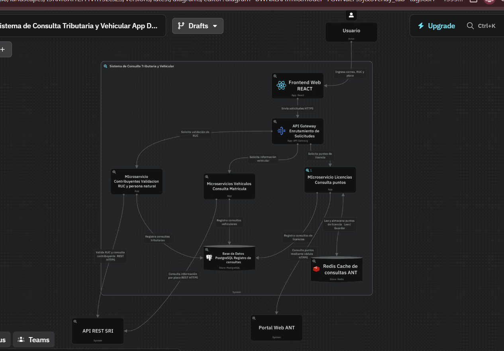
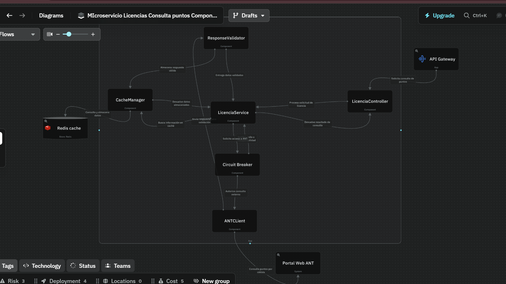

# Sistema de Consulta Tributaria y Vehicular — ISWZ2202

Prototipo que implementa el modelo C4 diseñado en IcePanel:

| Requisito | Implementación | Carpeta | Puerto |
|---|---|---|---|
| **Frontend React** | React 18 + Vite | `frontend/` | 5173 |
| **Backend Java** | API Gateway (Spring Cloud Gateway) | `api-gateway/` | 8080 |
|  | Microservicio Contribuyentes (RUC y persona natural) | `ms-contribuyentes/` | 8081 |
|  | Microservicio Vehículos (matrícula) | `ms-vehiculos/` | 8082 |
|  | Microservicio Licencias (puntos ANT) | `ms-licencias/` | 8083 |
| **Caché Cloud** | Redis en Upstash | — | — |

## Arquitectura (modelo C4 en IcePanel)

Explicación completa de cada nivel: **[docs/MODELO-C4.md](docs/MODELO-C4.md)**

| C1 – Contexto | C2 – Contenedores | C3 – Componentes (Licencias) |
|---|---|---|
|  |  |  |

C4 – Código: [docs/C4-Nivel4-Codigo.md](docs/C4-Nivel4-Codigo.md)

Evidencias de ejecución: [docs/EJECUCION.md](docs/EJECUCION.md)

## Patrones
- **API Gateway**: el frontend solo habla con `:8080`; el gateway enruta a cada microservicio y centraliza CORS.
- **Cache-Aside** (ms-licencias): si hay copia reciente (60 min) se responde desde Redis; si no, se consulta la ANT
  y **cada respuesta válida se guarda en Redis**; si la ANT falla, se responde con la última copia (`CACHE_RESPALDO`).
- **Circuit Breaker**: tras 3 fallos seguidos de la ANT deja de consultarla por 60 s y responde desde caché.

## Ejecutar (Windows)

**Requisitos:** JDK 17, Node.js 18+ y una base Redis gratis en [Upstash](https://upstash.com) (es web, no se instala).

```powershell
powershell -ExecutionPolicy Bypass -File .\iniciar.ps1
```
El script copia el Maven Wrapper si falta, pide la URL de Upstash (`rediss://...`) y abre una ventana por servicio.
Cuando todas digan `Started`, abre http://localhost:5173

## Endpoints (a través del gateway :8080)
| Método | Ruta | Microservicio |
|---|---|---|
| GET | `/api/contribuyentes/{ruc}?correo=` | ms-contribuyentes |
| GET | `/api/vehiculos/{placa}` | ms-vehiculos |
| GET | `/api/licencias/{cedula}?placa=` | ms-licencias |

## Pruebas
```powershell
cd ms-licencias; .\mvnw.cmd test   # CircuitBreakerTest + LicenciaServiceTest (sin Redis ni ANT reales)
```
