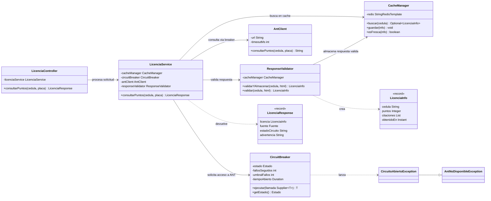
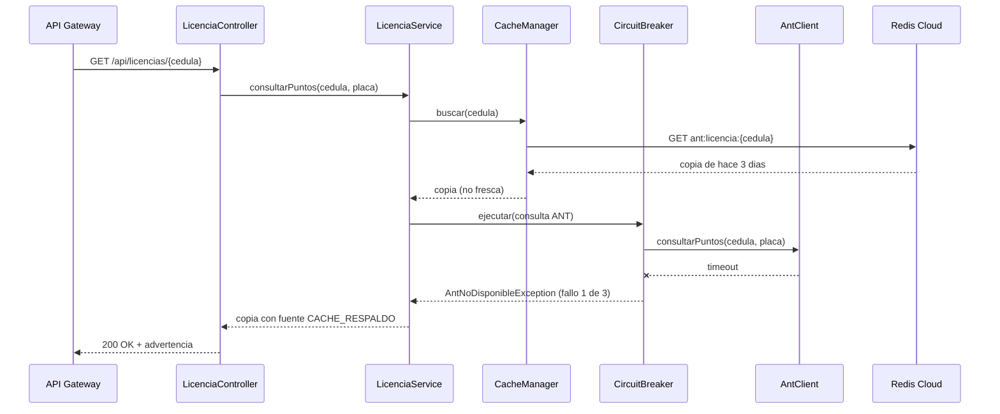
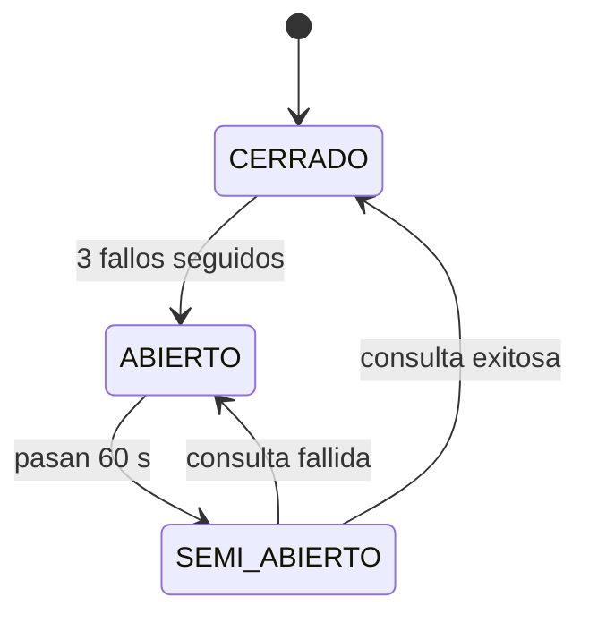
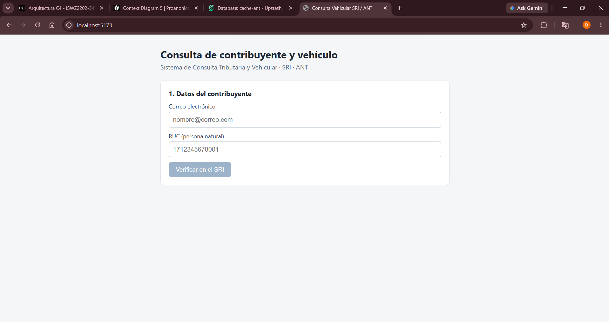
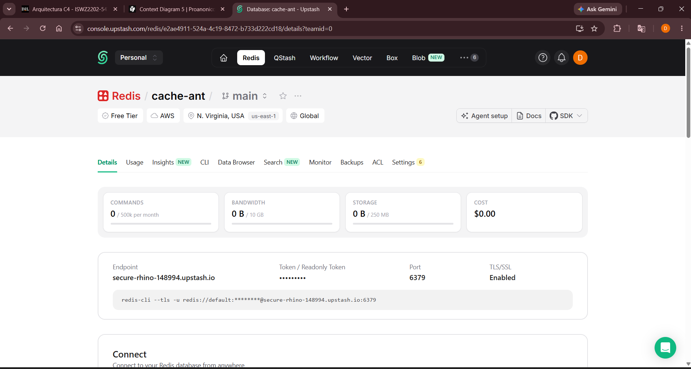

# Arquitectura C4: Sistema de Consulta Tributaria y Vehicular

**ISWZ2202 – Diseño y Arquitectura de Software · Universidad de las Américas**
Autor: Dereck Proaño

Sistema web que, a partir del **RUC de una persona natural**, verifica en el **SRI** que sea contribuyente,
muestra sus datos, consulta la **matrícula de su vehículo** y los **puntos de su licencia en la ANT**.
Como el portal de la ANT tiene muy baja disponibilidad, el sistema guarda en una **caché en la nube (Redis Cloud)**
cada respuesta válida y la devuelve desde allí cuando la ANT no responde.

La arquitectura se diseñó con el **modelo C4** en **IcePanel**, y este repositorio contiene su implementación.

| Requisito del enunciado | Cómo se cumple |
|---|---|
| Frontend en **React** | [`frontend/`](frontend): React 18 + Vite |
| Backend en **Java** | [`api-gateway/`](api-gateway) + 3 microservicios Spring Boot 3 (Java 17) |
| Microservicio que verifica el contribuyente | [`ms-contribuyentes/`](ms-contribuyentes) |
| Información del vehículo | [`ms-vehiculos/`](ms-vehiculos) |
| Microservicio de puntos de licencia (ANT) | [`ms-licencias/`](ms-licencias) |
| **Caché Cloud** con patrón para la baja disponibilidad | Redis en **Upstash** + patrones **Cache-Aside** y **Circuit Breaker** |
| Diagrama C4 en IcePanel enlazado a GitHub | Sección [Modelo C4](#modelo-c4) |

---

## Índice
1. [Modelo C4](#modelo-c4)
   - [C1 – Contexto](#c1--diagrama-de-contexto)
   - [C2 – Contenedores](#c2--diagrama-de-contenedores)
   - [C3 – Componentes](#c3--diagrama-de-componentes-microservicio-licencias)
   - [C4 – Código](#c4--código-microservicio-licencias)
2. [Patrones de diseño aplicados](#patrones-de-diseño-aplicados)
3. [Estructura del repositorio](#estructura-del-repositorio)
4. [Cómo ejecutarlo](#cómo-ejecutarlo)
5. [API](#api)
6. [Evidencias de ejecución](#evidencias-de-ejecución)
7. [Pruebas](#pruebas)

---

## Modelo C4

El modelo C4 describe un sistema en **4 niveles de zoom**. Cada nivel abre una caja del nivel anterior:

| Nivel | Pregunta que responde | Audiencia |
|---|---|---|
| **C1 – Contexto** | ¿Qué es el sistema, quién lo usa y con qué se comunica? | Cualquier persona |
| **C2 – Contenedores** | ¿De qué aplicaciones y almacenes de datos se compone? | Arquitectos y desarrolladores |
| **C3 – Componentes** | ¿Qué piezas hay dentro de un contenedor? | Desarrolladores |
| **C4 – Código** | ¿Con qué clases se implementa cada componente? | Desarrolladores |

### C1 – Diagrama de Contexto


**Qué muestra:** el sistema como una **caja negra**, la persona que lo usa y los sistemas externos de los que depende.
No se ve ninguna tecnología, solo responsabilidades.

| Elemento | Tipo | Descripción |
|---|---|---|
| **Usuario** | Actor | Persona natural que consulta su información tributaria y vehicular |
| **Sistema de Consulta Tributaria y Vehicular** | Sistema interno | El sistema que se construye en este repositorio |
| **SRI – Servicio de Rentas Internas** | Sistema externo | Expone APIs REST con el catastro de contribuyentes y la matriculación vehicular |
| **ANT – Agencia Nacional de Tránsito** | Sistema externo | Portal web con las citaciones y los puntos de la licencia. **Tiene baja disponibilidad** |

**Relaciones:**
- El **Usuario** *consulta información tributaria y vehicular* y el sistema le *muestra los resultados*.
- El sistema *consulta el contribuyente y el vehículo* en el **SRI**, que devuelve la *información tributaria y vehicular*.
- El sistema *consulta los puntos de licencia* en la **ANT**, que devuelve la *información de puntos*.

**Decisión clave de este nivel:** la ANT es un sistema externo poco confiable. Eso obliga a que el sistema no dependa
de ella en cada consulta, y lo resuelve el nivel C3 con caché y Circuit Breaker.

### C2 – Diagrama de Contenedores


**Qué muestra:** el interior del sistema, dividido en **aplicaciones que se ejecutan por separado** y en almacenes de
datos, con su tecnología y su forma de comunicarse.

| Contenedor | Tecnología | Responsabilidad | Código |
|---|---|---|---|
| **Frontend Web REACT** | React 18 + Vite | Formulario por pasos: correo + RUC → datos del contribuyente → placa → vehículo y puntos | [`frontend/`](frontend) |
| **API Gateway** | Spring Cloud Gateway | Punto único de entrada. Enruta cada solicitud a su microservicio y centraliza CORS | [`api-gateway/`](api-gateway) |
| **Microservicio Contribuyentes** | Java 17 + Spring Boot 3 | Valida el RUC y verifica que sea contribuyente y **persona natural** | [`ms-contribuyentes/`](ms-contribuyentes) |
| **Microservicio Vehículos** | Java 17 + Spring Boot 3 | Consulta la matrícula del vehículo por placa | [`ms-vehiculos/`](ms-vehiculos) |
| **Microservicio Licencias** | Java 17 + Spring Boot 3 + Jsoup | Consulta los puntos de licencia en la ANT aplicando caché y Circuit Breaker | [`ms-licencias/`](ms-licencias) |
| **Redis Cache de consultas ANT** | Redis Cloud (Upstash) | Guarda la última respuesta válida de la ANT por cédula | configurado en `ms-licencias` |

**Relaciones:**
- Usuario → Frontend: *ingresa correo, RUC y placa*.
- Frontend → API Gateway: *envía solicitudes HTTPS*. El frontend no conoce a los microservicios, solo al gateway.
- API Gateway → microservicios: *solicita validación de RUC*, *información vehicular* y *puntos de licencia*.
- Contribuyentes y Vehículos → **API REST SRI** (REST/JSON sobre HTTPS).
- Licencias → **Portal Web ANT** (HTTPS; la ANT responde **HTML**, que se procesa con Jsoup).
- Licencias ↔ **Redis Cloud**: *lee y almacena puntos de licencia*.

**Decisiones de este nivel:**
- **Un microservicio por fuente de datos.** Si la ANT falla, solo se afecta Licencias; contribuyentes y vehículos siguen funcionando.
- **API Gateway** para no exponer los puertos de cada microservicio al navegador y resolver CORS en un solo lugar.
- **Caché gestionada en la nube** para no instalar ni administrar un servidor Redis propio.

### C3 – Diagrama de Componentes (Microservicio Licencias)


**Qué muestra:** los componentes internos del **Microservicio Licencias**, el contenedor más crítico porque depende de la ANT.

| Componente | Responsabilidad |
|---|---|
| **LicenciaController** | Recibe del API Gateway la solicitud de consulta de puntos y devuelve el resultado |
| **LicenciaService** | Orquesta el flujo: primero la caché, luego la ANT y, si falla, la copia de respaldo |
| **CacheManager** | Busca y almacena datos en Redis |
| **Circuit Breaker** | Autoriza o bloquea la consulta externa según los fallos recientes de la ANT |
| **ANTClient** | Consulta los puntos por cédula en el Portal Web ANT |
| **ResponseValidator** | Valida la respuesta de la ANT. Solo las respuestas válidas se guardan en la caché |
| **Redis cache** | Almacén externo (Upstash) |

**Flujo, siguiendo las flechas del diagrama:**
1. API Gateway → **LicenciaController** → **LicenciaService** (*procesa solicitud de licencia*).
2. LicenciaService → **CacheManager** (*busca información en caché*). Si hay una copia reciente, *devuelve datos almacenados* y termina.
3. Si no hay copia reciente: LicenciaService → **Circuit Breaker** (*solicita acceso a ANT*) → **ANTClient** (*autoriza consulta externa*) → **Portal Web ANT**.
4. ANTClient → **ResponseValidator** (*envía respuesta para validación*). Si es válida: → **CacheManager** (*almacena respuesta válida*) y → **LicenciaService** (*entrega datos validados*).
5. Si la ANT falla o el circuito está abierto, el **Circuit Breaker** *notifica el fallo* y LicenciaService devuelve la última copia guardada.

### C4 – Código (Microservicio Licencias)

**Qué muestra:** cómo cada componente del C3 se implementa en **clases Java**. En IcePanel este nivel no se dibuja
con cajas: **cada componente del C3 está enlazado a su archivo en este repositorio**.

| Componente (C3) | Clase (C4) | Paquete |
|---|---|---|
| LicenciaController | [`LicenciaController`](ms-licencias/src/main/java/ec/udla/licencias/controller/LicenciaController.java) | `controller` |
| LicenciaService | [`LicenciaService`](ms-licencias/src/main/java/ec/udla/licencias/service/LicenciaService.java) | `service` |
| CacheManager | [`CacheManager`](ms-licencias/src/main/java/ec/udla/licencias/cache/CacheManager.java) | `cache` |
| Circuit Breaker | [`CircuitBreaker`](ms-licencias/src/main/java/ec/udla/licencias/resilience/CircuitBreaker.java) | `resilience` |
| ANTClient | [`AntClient`](ms-licencias/src/main/java/ec/udla/licencias/client/AntClient.java) | `client` |
| ResponseValidator | [`ResponseValidator`](ms-licencias/src/main/java/ec/udla/licencias/validator/ResponseValidator.java) | `validator` |
| Redis cache | [`application.properties`](ms-licencias/src/main/resources/application.properties) (`spring.data.redis.url`) | `resources` |

#### Diagrama de clases



#### Secuencia: consulta con la ANT caída



Los diagramas de clases de los otros dos microservicios están en [`docs/C4-Nivel4-Codigo.md`](docs/C4-Nivel4-Codigo.md).

---

## Patrones de diseño aplicados

### Cache-Aside con respaldo ante fallo (stale-if-error)
Lo pide el enunciado: *"almacenar la información en caché cada vez que se obtenga una respuesta adecuada y devolver la información desde allí"*.

| Situación | Qué hace el sistema | `fuente` en la respuesta |
|---|---|---|
| Hay copia con menos de 60 min en Redis | Responde desde Redis, sin llamar a la ANT | `CACHE` |
| No hay copia reciente y la ANT responde bien | Valida, **guarda en Redis** y responde | `ANT` |
| La ANT falla y hay una copia antigua | Responde con la copia y una advertencia | `CACHE_RESPALDO` |
| La ANT falla y no hay copia | Error 503 | — |

Las respuestas inválidas (página de error, HTML vacío, puntos fuera de rango) **nunca se guardan** en la caché.
La copia se conserva 30 días en Redis como respaldo.

### Circuit Breaker
Si la ANT falla **3 veces seguidas**, el circuito pasa a **ABIERTO** y durante **60 s** no se vuelve a llamar a la ANT:
se responde de inmediato desde la caché, sin esperar el timeout de 8 s. Luego pasa a **SEMI_ABIERTO** y deja pasar
una consulta de prueba: si funciona, vuelve a **CERRADO**.



### API Gateway
El frontend solo conoce `http://localhost:8080`. El gateway enruta `/api/contribuyentes/**`, `/api/vehiculos/**` y
`/api/licencias/**` a cada microservicio y aplica CORS en un único punto.

### Bajo acoplamiento
Cada microservicio separa **controlador → servicio → cliente externo**. `LicenciaService` recibe sus dependencias por
constructor, así que las pruebas reemplazan Redis y la ANT por dobles (Mockito) sin levantar nada real.

---

## Estructura del repositorio

```
ArquitecturaC4/
├── frontend/              React 18 + Vite (puerto 5173)
├── api-gateway/           Spring Cloud Gateway (8080)
├── ms-contribuyentes/     Spring Boot: SRI catastro (8081)
├── ms-vehiculos/          Spring Boot: SRI matriculación (8082)
├── ms-licencias/          Spring Boot: ANT + Redis + Circuit Breaker (8083)
│   └── src/main/java/ec/udla/licencias/
│       ├── controller/    LicenciaController, ManejadorErrores
│       ├── service/       LicenciaService
│       ├── cache/         CacheManager
│       ├── resilience/    CircuitBreaker
│       ├── client/        AntClient
│       ├── validator/     ResponseValidator
│       ├── dto/           LicenciaInfo, LicenciaResponse
│       └── exception/     AntNoDisponibleException, CircuitoAbiertoException
├── docs/
│   ├── img/               Capturas C1–C3 y de ejecución
│   └── C4-Nivel4-Codigo.md
└── iniciar.ps1            Levanta todo con un comando
```

---

## Cómo ejecutarlo

**Requisitos:** JDK 17, Node.js 18+ y una base Redis gratuita en [Upstash](https://upstash.com) (es web, no se instala nada).

```powershell
git clone https://github.com/Ijloy/ArquitecturaC4.git
cd ArquitecturaC4
powershell -ExecutionPolicy Bypass -File .\iniciar.ps1
```

El script:
1. Copia el Maven Wrapper en cada microservicio si falta (`-WrapperDesde "ruta\a\un\proyecto-spring"`).
2. Pide la URL de Redis Cloud: `rediss://default:<TOKEN>@<host>.upstash.io:6379`.
3. Abre una ventana por servicio. Cuando todas digan `Started`, entra a **http://localhost:5173**.

> La credencial de Redis **no está en el repositorio**: se pasa por la variable de entorno `REDIS_URL`.

---

## API

Todas las rutas pasan por el API Gateway (`http://localhost:8080`):

| Método | Ruta | Microservicio | Respuesta |
|---|---|---|---|
| GET | `/api/contribuyentes/{ruc}?correo=` | Contribuyentes | `esContribuyente`, `esPersonaNatural`, `cedula`, datos del SRI |
| GET | `/api/vehiculos/{placa}` | Vehículos | Datos del vehículo (404 si no existe) |
| GET | `/api/licencias/{cedula}?placa=` | Licencias | `puntos`, `citaciones`, `fuente`, `estadoCircuito`, `advertencia` |

APIs externas consumidas:
- SRI: `ConsolidadoContribuyente/existePorNumeroRuc`, `ConsolidadoContribuyente/obtenerPorNumerosRuc`, `BaseVehiculo/obtenerPorNumeroPlacaOPorNumeroCampvOPorNumeroCpn`
- ANT: `PortalWEB/paginas/clientes/clp_grid_citaciones.jsp`

---

## Evidencias de ejecución

### 1. Frontend React en `localhost:5173`


La aplicación React corre en `http://localhost:5173`. El primer paso pide el **correo** y el **RUC de persona natural**
(13 dígitos); el botón se habilita cuando ambos son válidos. Al pulsarlo, la solicitud va al API Gateway, que la
enruta al Microservicio Contribuyentes.

### 2. Caché Cloud: base Redis en Upstash


Base `cache-ant` creada en **Upstash** (AWS N. Virginia, plan gratuito, TLS habilitado). El Microservicio Licencias
se conecta a ella con `rediss://` y guarda cada respuesta válida de la ANT con la clave `ant:licencia:{cedula}`.

---

## Pruebas

```powershell
cd ms-licencias
.\mvnw.cmd test
```

| Prueba | Qué verifica |
|---|---|
| `CircuitBreakerTest` | Se abre tras 3 fallos, se prueba de nuevo a los 60 s, se cierra si funciona y se reabre si falla |
| `LicenciaServiceTest` | Copia fresca sin llamar a la ANT, respuesta válida de la ANT, respaldo con la ANT caída, error sin copia, y que el circuito deja de llamar a la ANT tras 3 fallos |

Las pruebas usan dobles de prueba (Mockito), así que no necesitan Redis ni la ANT.
