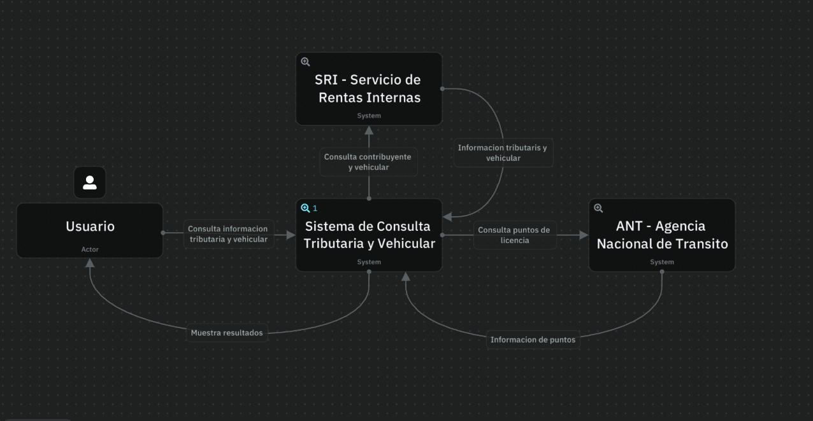

# Sistema de Consulta Tributaria y Vehicular — ISWZ2202

Prototipo que implementa el modelo C4 diseñado en IcePanel:

| Contenedor (C2) | Carpeta | Tecnología | Puerto |
|---|---|---|---|
| Frontend Web REACT | `frontend/` | React 18 + Vite | 5173 |
| API Gateway (enrutamiento) | `api-gateway/` | Spring Cloud Gateway | 8080 |
| Microservicio Contribuyentes (RUC y persona natural) | `ms-contribuyentes/` | Spring Boot 3.3, Java 17 | 8081 |
| Microservicio Vehículos (matrícula) | `ms-vehiculos/` | Spring Boot 3.3, Java 17 | 8082 |
| Microservicio Licencias (puntos) | `ms-licencias/` | Spring Boot 3.3, Jsoup, Redis | 8083 |
| Base de datos PostgreSQL (registro de consultas) | `docker-compose.yml` | PostgreSQL 16 | 5432 |
| Redis Cache de consultas ANT | Upstash (cloud) | Redis | 6379 |

## Arquitectura (modelo C4 en IcePanel)

Explicación completa de cada nivel: **[docs/MODELO-C4.md](docs/MODELO-C4.md)**

| C1 – Contexto | C2 – Contenedores | C3 – Componentes (Licencias) |
|---|---|---|
|  |  |  |

C4 – Código: [docs/C4-Nivel4-Codigo.md](docs/C4-Nivel4-Codigo.md)

Evidencias de ejecución: [docs/EJECUCION.md](docs/EJECUCION.md)

## Patrones
- **API Gateway**: el frontend solo habla con `:8080`; el gateway enruta y centraliza CORS.
- **Cache-Aside** (ms-licencias): copia fresca (60 min) → se responde desde Redis; si no, se consulta la ANT
  y **cada respuesta válida se guarda en Redis**; si la ANT falla, se responde con la última copia (`CACHE_RESPALDO`).
- **Circuit Breaker**: tras 3 fallos seguidos de la ANT deja de consultarla 60 s y responde desde caché.
- **Registro de consultas**: cada microservicio guarda sus consultas en PostgreSQL.

## Ejecutar (Windows PowerShell)

1. Infraestructura local: `docker compose up -d postgres` (o `docker compose up -d` si también quieres Redis local).
2. Caché Cloud: crea una base Redis en https://upstash.com y copia la URL TLS.
3. Una terminal por servicio:
```powershell
cd ms-contribuyentes; mvn spring-boot:run
cd ms-vehiculos;      mvn spring-boot:run
cd ms-licencias;      $env:REDIS_URL="rediss://default:<password>@<host>.upstash.io:6379"; mvn spring-boot:run
cd api-gateway;       mvn spring-boot:run
cd frontend;          copy .env.example .env; npm install; npm run dev
```
4. Abrir http://localhost:5173

> Si no tienes Maven instalado, copia `mvnw`, `mvnw.cmd` y la carpeta `.mvn` de cualquier proyecto Spring Boot
> en cada microservicio y usa `.\mvnw.cmd spring-boot:run`.

## Endpoints (a través del gateway :8080)
| Método | Ruta | Microservicio |
|---|---|---|
| GET | `/api/contribuyentes/{ruc}?correo=` | ms-contribuyentes |
| GET | `/api/vehiculos/{placa}` | ms-vehiculos |
| GET | `/api/licencias/{cedula}?placa=` | ms-licencias |

## Pruebas
```powershell
cd ms-licencias; mvn test   # CircuitBreakerTest + LicenciaServiceTest (sin Redis/ANT/BD reales)
```
