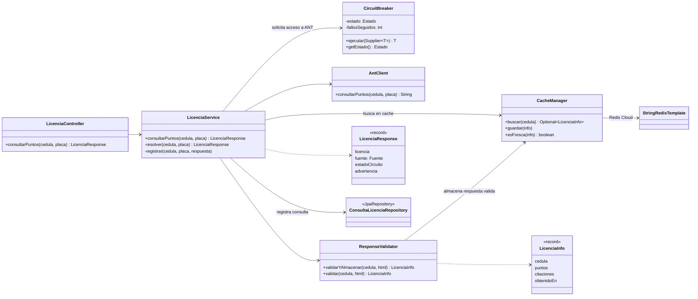

# C4 Nivel 4 — Código del Microservicio Licencias

El nivel 4 de C4 baja de cada **componente** del nivel 3 a las **clases** que lo implementan.
En IcePanel no se dibuja con cajas: se hace **enlazando cada componente con su archivo en GitHub**.
Este documento (GitHub dibuja el diagrama Mermaid de abajo) sirve como vista de clases.

## Componente (C3) → Clase (C4)

| Componente en IcePanel | Clase Java | Responsabilidad |
|---|---|---|
| LicenciaController | [`controller/LicenciaController.java`](https://github.com/Ijloy/sistema-consulta-tributaria-vehicular/blob/main/ms-licencias/src/main/java/ec/udla/licencias/controller/LicenciaController.java) | Recibe del API Gateway `GET /api/licencias/{cedula}?placa=` |
| LicenciaService | [`service/LicenciaService.java`](https://github.com/Ijloy/sistema-consulta-tributaria-vehicular/blob/main/ms-licencias/src/main/java/ec/udla/licencias/service/LicenciaService.java) | Orquesta Cache-Aside + Circuit Breaker y registra la consulta |
| CacheManager | [`cache/CacheManager.java`](https://github.com/Ijloy/sistema-consulta-tributaria-vehicular/blob/main/ms-licencias/src/main/java/ec/udla/licencias/cache/CacheManager.java) | Busca y almacena en Redis (clave `ant:licencia:{cedula}`) |
| Circuit Breaker | [`resilience/CircuitBreaker.java`](https://github.com/Ijloy/sistema-consulta-tributaria-vehicular/blob/main/ms-licencias/src/main/java/ec/udla/licencias/resilience/CircuitBreaker.java) | CERRADO / ABIERTO / SEMI_ABIERTO; autoriza la consulta externa |
| ANTClient | [`client/AntClient.java`](https://github.com/Ijloy/sistema-consulta-tributaria-vehicular/blob/main/ms-licencias/src/main/java/ec/udla/licencias/client/AntClient.java) | Llama al Portal Web ANT y devuelve el HTML |
| ResponseValidator | [`validator/ResponseValidator.java`](https://github.com/Ijloy/sistema-consulta-tributaria-vehicular/blob/main/ms-licencias/src/main/java/ec/udla/licencias/validator/ResponseValidator.java) | Valida el HTML, extrae puntos/citaciones y almacena solo respuestas válidas |
| Redis cache (Store) | [`application.properties`](https://github.com/Ijloy/sistema-consulta-tributaria-vehicular/blob/main/ms-licencias/src/main/resources/application.properties) | `spring.data.redis.url` → Redis Cloud (Upstash) |
| (registro) | [`registro/ConsultaLicencia.java`](https://github.com/Ijloy/sistema-consulta-tributaria-vehicular/blob/main/ms-licencias/src/main/java/ec/udla/licencias/registro/ConsultaLicencia.java) | Tabla `consulta_licencia` en PostgreSQL |

## Diagrama de clases

## Secuencia (Flow "Consulta con ANT caída")

1. API Gateway → LicenciaController → LicenciaService
2. LicenciaService → CacheManager.buscar(cedula): copia de hace 3 días (no fresca)
3. LicenciaService → CircuitBreaker.ejecutar(...) → AntClient → **timeout**
4. CircuitBreaker cuenta el fallo (al 3.º seguido se ABRE y deja de llamar a la ANT por 60 s)
5. LicenciaService devuelve la copia con `fuente = CACHE_RESPALDO` y advertencia
6. LicenciaService registra la consulta en PostgreSQL
