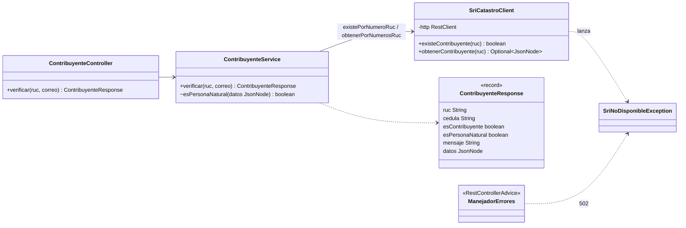
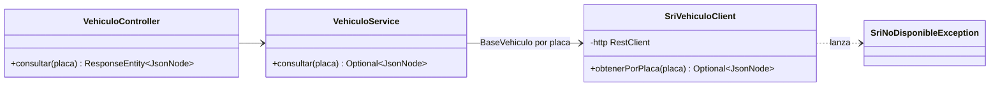

# C4 Nivel 4: Código de los tres microservicios

El nivel 4 de C4 baja de cada componente a las **clases** que lo implementan.
El microservicio principal (Licencias) está explicado en el [README](../README.md#c4--código-microservicio-licencias).
Aquí están también los diagramas de clases de Contribuyentes y Vehículos.

## Microservicio Licencias

| Componente (C3) | Clase |
|---|---|
| LicenciaController | [`controller/LicenciaController.java`](../ms-licencias/src/main/java/ec/udla/licencias/controller/LicenciaController.java) |
| LicenciaService | [`service/LicenciaService.java`](../ms-licencias/src/main/java/ec/udla/licencias/service/LicenciaService.java) |
| CacheManager | [`cache/CacheManager.java`](../ms-licencias/src/main/java/ec/udla/licencias/cache/CacheManager.java) |
| Circuit Breaker | [`resilience/CircuitBreaker.java`](../ms-licencias/src/main/java/ec/udla/licencias/resilience/CircuitBreaker.java) |
| ANTClient | [`client/AntClient.java`](../ms-licencias/src/main/java/ec/udla/licencias/client/AntClient.java) |
| ResponseValidator | [`validator/ResponseValidator.java`](../ms-licencias/src/main/java/ec/udla/licencias/validator/ResponseValidator.java) |

## Microservicio Contribuyentes

| Clase | Archivo |
|---|---|
| ContribuyenteController | [`controller/ContribuyenteController.java`](../ms-contribuyentes/src/main/java/ec/udla/contribuyentes/controller/ContribuyenteController.java) |
| ContribuyenteService | [`service/ContribuyenteService.java`](../ms-contribuyentes/src/main/java/ec/udla/contribuyentes/service/ContribuyenteService.java) |
| SriCatastroClient | [`client/SriCatastroClient.java`](../ms-contribuyentes/src/main/java/ec/udla/contribuyentes/client/SriCatastroClient.java) |

## Microservicio Vehículos

| Clase | Archivo |
|---|---|
| VehiculoController | [`controller/VehiculoController.java`](../ms-vehiculos/src/main/java/ec/udla/vehiculos/controller/VehiculoController.java) |
| VehiculoService | [`service/VehiculoService.java`](../ms-vehiculos/src/main/java/ec/udla/vehiculos/service/VehiculoService.java) |
| SriVehiculoClient | [`client/SriVehiculoClient.java`](../ms-vehiculos/src/main/java/ec/udla/vehiculos/client/SriVehiculoClient.java) |

## API Gateway

No tiene clases propias más allá de `ApiGatewayApplication`: las rutas se declaran en
[`application.yml`](../api-gateway/src/main/resources/application.yml).
