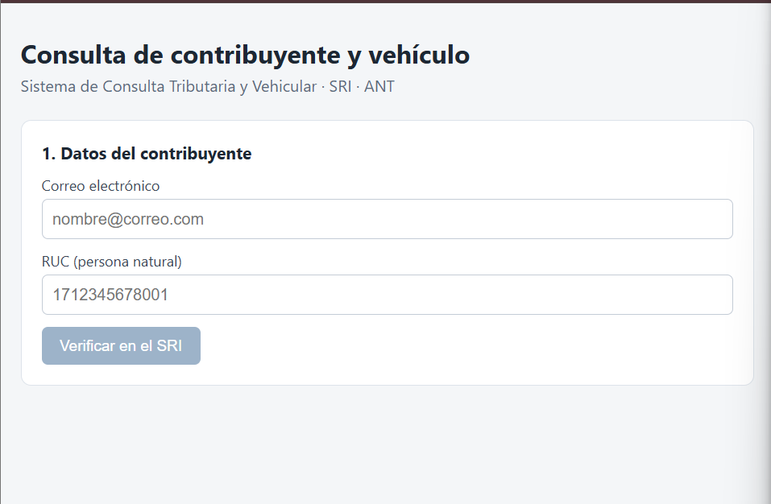

# Evidencias de ejecución

## 1. Frontend React — pantalla inicial

La aplicación React (Vite) corre en `http://localhost:5173`. El primer paso pide el **correo electrónico** y el
**RUC de persona natural** (13 dígitos). El botón **Verificar en el SRI** se habilita solo cuando el correo tiene
formato válido y el RUC tiene 13 dígitos. Al pulsarlo, el frontend envía la solicitud al **API Gateway**
(`GET /api/contribuyentes/{ruc}?correo=`), que la enruta al **Microservicio Contribuyentes**.
