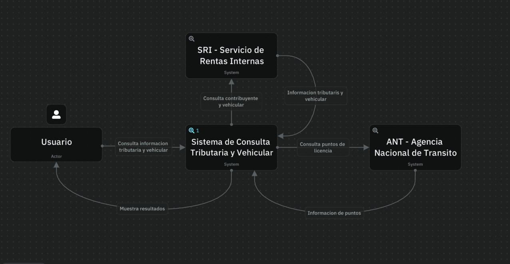
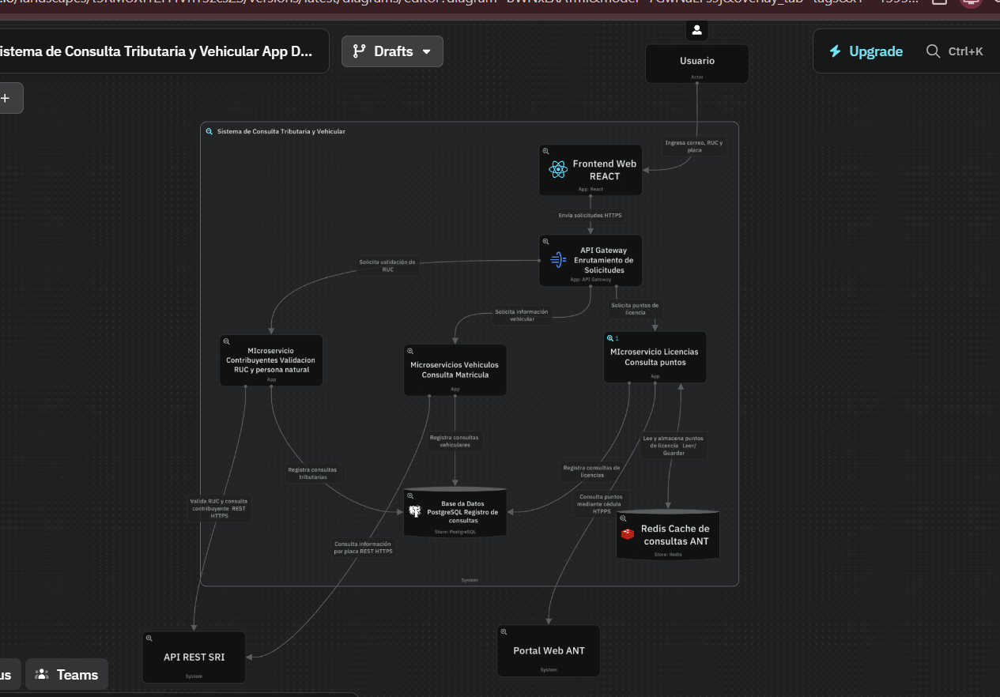
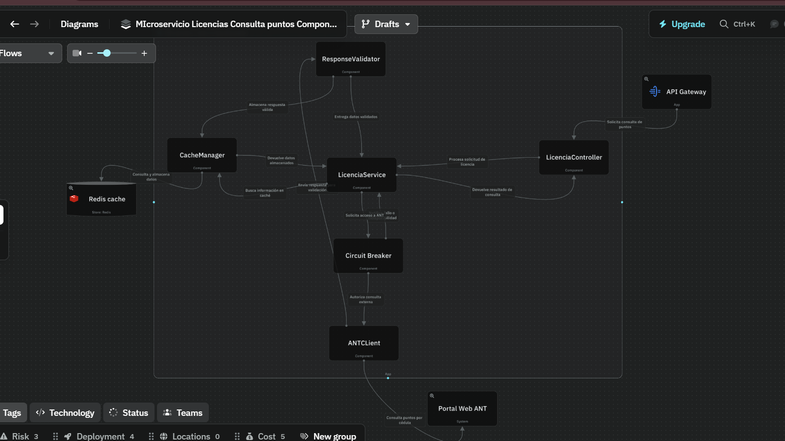

# Modelo C4 — Sistema de Consulta Tributaria y Vehicular

Diagramas elaborados en **IcePanel** siguiendo el modelo C4 (Contexto → Contenedores → Componentes → Código).
Cada nivel hace *zoom* sobre un elemento del nivel anterior.

---

## C1 — Diagrama de Contexto

**Qué muestra:** el sistema como una sola caja, quién lo usa y con qué sistemas externos se comunica.

| Elemento | Tipo | Rol |
|---|---|---|
| Usuario | Actor | Persona natural que consulta su información tributaria y vehicular |
| Sistema de Consulta Tributaria y Vehicular | Sistema (interno) | El sistema que construimos |
| SRI – Servicio de Rentas Internas | Sistema externo | Fuente de datos del contribuyente y del vehículo (API REST) |
| ANT – Agencia Nacional de Tránsito | Sistema externo | Fuente de los puntos de licencia (portal web de **baja disponibilidad**) |

**Relaciones:**
- Usuario → Sistema: *Consulta información tributaria y vehicular*; Sistema → Usuario: *Muestra resultados*.
- Sistema → SRI: *Consulta contribuyente y vehicular*; SRI → Sistema: *Información tributaria y vehicular*.
- Sistema → ANT: *Consulta puntos de licencia*; ANT → Sistema: *Información de puntos*.

---

## C2 — Diagrama de Contenedores

**Qué muestra:** el interior del sistema dividido en aplicaciones y almacenes de datos que se despliegan por separado, con su tecnología y cómo se comunican.

| Contenedor | Tecnología | Responsabilidad | Código |
|---|---|---|---|
| Frontend Web REACT | React 18 + Vite | Formulario por pasos: correo + RUC → datos del contribuyente → placa → vehículo y puntos | [`frontend/`](../frontend) |
| API Gateway – Enrutamiento de solicitudes | Spring Cloud Gateway | Punto único de entrada; enruta a cada microservicio y centraliza CORS | [`api-gateway/`](../api-gateway) |
| Microservicio Contribuyentes | Java 17 + Spring Boot | Valida el RUC, verifica que sea contribuyente y persona natural | [`ms-contribuyentes/`](../ms-contribuyentes) |
| Microservicio Vehículos | Java 17 + Spring Boot | Consulta la matrícula del vehículo por placa | [`ms-vehiculos/`](../ms-vehiculos) |
| Microservicio Licencias | Java 17 + Spring Boot + Jsoup | Consulta los puntos de licencia en la ANT con caché y Circuit Breaker | [`ms-licencias/`](../ms-licencias) |
| Redis Cache de consultas ANT | Redis Cloud (Upstash) | Guarda la última respuesta válida de la ANT por cédula | `ms-licencias/.../cache` |

**Relaciones principales:**
- Usuario → Frontend: *Ingresa correo, RUC y placa*. Frontend → API Gateway: *Envía solicitudes HTTPS*.
- API Gateway → cada microservicio: *Solicita validación de RUC / información vehicular / puntos de licencia*.
- Contribuyentes y Vehículos → API REST SRI (REST HTTPS). Licencias → Portal Web ANT (HTTPS, la respuesta es HTML).
- Licencias ↔ Redis: *Lee y almacena puntos de licencia*.

---

## C3 — Diagrama de Componentes (Microservicio Licencias)

**Qué muestra:** los componentes internos del Microservicio Licencias, que es donde se resuelve el problema de la baja disponibilidad de la ANT.

| Componente | Responsabilidad |
|---|---|
| LicenciaController | Recibe del API Gateway la solicitud de consulta de puntos y devuelve el resultado |
| LicenciaService | Orquesta el flujo: primero caché, luego ANT, y respaldo si la ANT falla |
| CacheManager | Busca y almacena datos en Redis Cache |
| Circuit Breaker | Autoriza o bloquea la consulta externa según los fallos recientes de la ANT |
| ANTClient | Consulta los puntos por cédula en el Portal Web ANT |
| ResponseValidator | Valida la respuesta de la ANT; solo las respuestas válidas se almacenan en caché |
| Redis cache | Almacén externo (Store: Redis) |

**Flujo:**
1. API Gateway → LicenciaController → LicenciaService (*Procesa solicitud de licencia*).
2. LicenciaService → CacheManager (*Busca información en caché*). Si hay una copia reciente → *Devuelve datos almacenados*.
3. Si no hay copia → LicenciaService → Circuit Breaker (*Solicita acceso a ANT*) → ANTClient (*Autoriza consulta externa*) → Portal Web ANT.
4. ANTClient → ResponseValidator (*Envía respuesta para validación*) → CacheManager (*Almacena respuesta válida*) y → LicenciaService (*Entrega datos validados*).
5. Si la ANT falla o el circuito está abierto → se devuelve la última copia del caché.

**Patrones aplicados:** Cache-Aside con respaldo ante fallo (stale-if-error) y Circuit Breaker.

---

## C4 — Código (Microservicio Licencias)

**Qué muestra:** cómo cada componente del C3 se implementa en clases Java. En IcePanel cada componente está **enlazado a su archivo en este repositorio**.

| Componente (C3) | Clase (C4) |
|---|---|
| LicenciaController | [`controller/LicenciaController.java`](../ms-licencias/src/main/java/ec/udla/licencias/controller/LicenciaController.java) |
| LicenciaService | [`service/LicenciaService.java`](../ms-licencias/src/main/java/ec/udla/licencias/service/LicenciaService.java) |
| CacheManager | [`cache/CacheManager.java`](../ms-licencias/src/main/java/ec/udla/licencias/cache/CacheManager.java) |
| Circuit Breaker | [`resilience/CircuitBreaker.java`](../ms-licencias/src/main/java/ec/udla/licencias/resilience/CircuitBreaker.java) |
| ANTClient | [`client/AntClient.java`](../ms-licencias/src/main/java/ec/udla/licencias/client/AntClient.java) |
| ResponseValidator | [`validator/ResponseValidator.java`](../ms-licencias/src/main/java/ec/udla/licencias/validator/ResponseValidator.java) |

Diagrama de clases y secuencia: [`C4-Nivel4-Codigo.md`](C4-Nivel4-Codigo.md)

<!-- CAPTURAS_C4 -->
